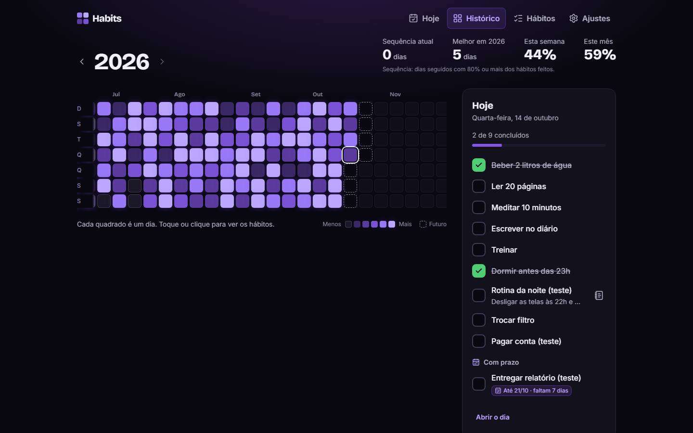
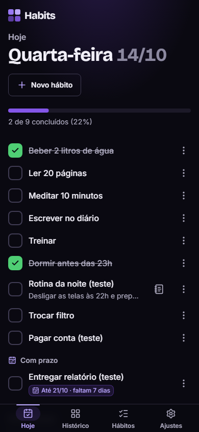
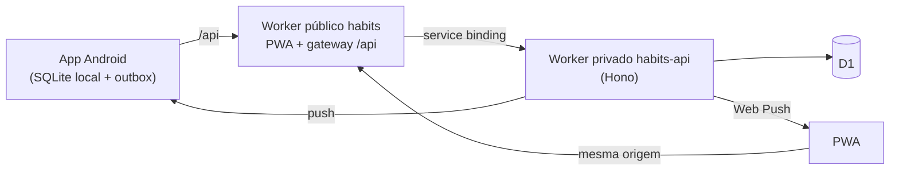

# Habits

[](https://github.com/Ranieeery/Habits-tracker/actions/workflows/ci.yml)

Rastreador de hábitos pessoal com heatmap no estilo das contribuições do GitHub. Você cria hábitos com a repetição que quiser, marca o que fez a cada dia e cada dia do ano vira um quadrado mais claro quanto mais você cumpriu. O app Android funciona offline; o PWA web faz o mesmo no navegador.

**Status:** projeto pessoal em uso, com desenvolvimento ocasional e sem prazos ([roadmap](docs/ROADMAP.md)).





## Funcionalidades

- **Heatmap do ano** com navegação entre anos, sequência atual, melhor sequência, semana e mês, e a **prévia dos próximos 7 dias** (somente leitura).
- **Repetições flexíveis:** dias da semana, a cada N dias, dias do mês, data única, todo ano e **tarefas com prazo** ("Até uma data").
- **Hoje:** marcar e desmarcar com "Desfazer"; **atrasados** (hábitos de dia fixo perdidos ficam na lista por até 15 dias); grupo "Com prazo"; "Próximos".
- **Editar dias passados** até 30 dias atrás, depois de uma confirmação.
- **Adiar uma ocorrência** de data única ou de dias do mês (até 2 vezes), sem falha no dia original.
- **Menu de ações** em cada linha (editar, adiar, ver descrição, arquivar), **descrições** com um pouco de Markdown, ordem personalizada, arquivar e apagar com "Desfazer".
- **Notificações push** no Android (Expo) e na web (Web Push): resumo da manhã às 09:00 e lembrete no horário escolhido.
- **Offline-first no Android:** os dados ficam num SQLite no aparelho e sincronizam com o servidor quando há rede, inclusive em segundo plano.
- **PWA instalável**, com atualização sob demanda.
- **Conta de dono único:** o cadastro fecha depois da primeira conta; o modelo de dados separa tudo por usuário.

## Stack

| Parte         | Tecnologias                                                                                                                       |
| ------------- | --------------------------------------------------------------------------------------------------------------------------------- |
| API           | Hono em Cloudflare Workers, D1 (SQLite) com Drizzle ORM, Better Auth, Zod (`@hono/zod-openapi`), Cron Trigger                     |
| Web           | React 19, Vite, TanStack Router e Query, Tailwind CSS v4, shadcn/ui (Radix), vite-plugin-pwa                                      |
| Mobile        | Expo SDK 57, React Native, Expo Router, NativeWind 4 (Tailwind v3), Reanimated, expo-sqlite, expo-notifications, EAS Build/Update |
| Compartilhado | TypeScript (strict), pnpm workspaces, Turborepo, Vitest, ESLint, Prettier                                                         |
| Infra         | Cloudflare Workers + D1 + R2 (backups), GitHub Actions, EAS; cabe nos planos gratuitos                                            |

## Arquitetura



As regras de domínio (datas, agendas, contagens, sync) ficam num pacote puro (`packages/core`) usado pela API e pelos dois clientes. Detalhes em [docs/ARCHITECTURE.md](docs/ARCHITECTURE.md).

## Como rodar localmente

Requisitos: Node 24 (`.node-version`) e pnpm 12 (`corepack enable`).

```bash
pnpm install --frozen-lockfile
cp apps/api/.dev.vars.example apps/api/.dev.vars   # preencha BETTER_AUTH_SECRET (o comando está no arquivo)
cp apps/web/.env.example apps/web/.env
pnpm --filter api db:migrate:local
pnpm --filter api db:seed:local                    # usuário dev@habits.local / habits-dev-password
pnpm dev                                           # API em http://localhost:8787 e web em http://localhost:5173
```

O app Android precisa de um development build (não roda no Expo Go): veja [docs/DEVELOPMENT.md](docs/DEVELOPMENT.md#app-mobile-development-build).

## Estrutura

```text
apps/
  api/             API (Worker privado), D1, cron de lembretes e expurgo
  web/             PWA (Worker público: assets + gateway /api)
  mobile/          App Expo (Android)
packages/
  contracts/       Schemas Zod de requisições, respostas e do protocolo de sync
  core/            Lógica de domínio pura (datas, agendas, heatmap, regras de sync)
  api-client/      Cliente tipado da API
  design-tokens/   Tokens visuais, ícones e splash
docs/              Arquitetura, decisões, desenvolvimento, deploy, roadmap
.github/           Workflows de CI/CD e Dependabot
```

## Testes e qualidade

```bash
pnpm typecheck && pnpm lint && pnpm test
```

Testes com Vitest em todos os pacotes: regras de domínio no `core`, a API dentro do runtime dos Workers com um D1 de teste, a web com Testing Library e o banco local e o sync do mobile em SQLite. O CI roda também formatação, guarda de migrations destrutivas, build da web, bundle do mobile e um deploy de teste (`--dry-run`) dos Workers.

## Documentação

- [Arquitetura](docs/ARCHITECTURE.md): modelo de dados, API, autenticação, sync, notificações e regras dos hábitos.
- [Decisões](docs/DECISIONS.md): o que foi escolhido e por quê.
- [Desenvolvimento](docs/DEVELOPMENT.md): setup, comandos, testes, convenções e versionamento.
- [Deploy e operação](docs/DEPLOYMENT.md): como publicar a sua instância, rollback, backups e segredos.
- [Roadmap](docs/ROADMAP.md) e [verificações manuais](docs/MANUAL-CHECKS.md).
- [Design](DESIGN.md): identidade visual e componentes.
- [Changelog](CHANGELOG.md): histórico de versões. A 2.0.0 foi uma reescrita completa do app 1.x (no histórico do git, tag `legacy-1.x`).

## Licença

[MIT](LICENSE). Para reportar vulnerabilidades, veja [SECURITY.md](SECURITY.md).
