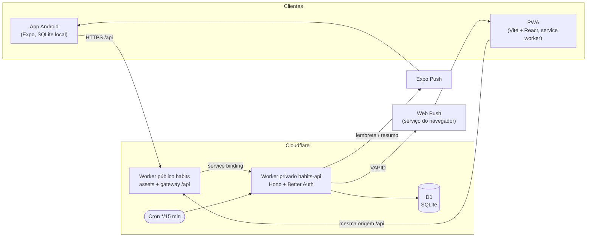

# Arquitetura

Como o Habits é montado e quais regras de domínio valem em todo lugar. As justificativas de cada escolha estão em [DECISIONS.md](DECISIONS.md); comandos em [DEVELOPMENT.md](DEVELOPMENT.md); operação em [DEPLOYMENT.md](DEPLOYMENT.md); identidade visual em [DESIGN.md](../DESIGN.md).

## Sumário

- [Visão geral](#visão-geral)
- [Monorepo](#monorepo)
- [Datas e fuso horário](#datas-e-fuso-horário)
- [Modelo de dados](#modelo-de-dados)
- [Regras dos hábitos](#regras-dos-hábitos)
- [API](#api)
- [Autenticação](#autenticação)
- [Notificações push e cron](#notificações-push-e-cron)
- [Sincronização offline (mobile)](#sincronização-offline-mobile)
- [Clientes](#clientes)
- [Compatibilidade entre versões](#compatibilidade-entre-versões)

## Visão geral

Um usuário real (o dono), mas cada linha do banco tem `user_id`, então várias contas seriam possíveis. O app Android (Expo) é o cliente principal e funciona offline; o PWA web é secundário, completo e só online.

## Monorepo

pnpm workspaces + Turborepo. Os pacotes internos exportam TypeScript direto (sem build); imports relativos usam a extensão `.ts`.

| Pasta                    | Papel                                                                                                                                                                               |
| ------------------------ | ----------------------------------------------------------------------------------------------------------------------------------------------------------------------------------- |
| `apps/api`               | Hono em Cloudflare Workers, D1 via Drizzle. O único backend.                                                                                                                        |
| `apps/web`               | PWA (Vite + React 19), publicado como o Worker público `habits` (assets estáticos + gateway `/api`).                                                                                |
| `apps/mobile`            | Expo + Expo Router. Cliente principal (Android).                                                                                                                                    |
| `packages/contracts`     | Schemas Zod e tipos de toda requisição, resposta e do protocolo de sync. Fonte única dos formatos.                                                                                  |
| `packages/core`          | Lógica de domínio pura: datas, agendas, proporções, sequências, grade do heatmap, regras de sync. Sem I/O, sem framework, com testes.                                               |
| `packages/api-client`    | Cliente tipado (Hono RPC `hc`) sobre as declarações `AppType` emitidas por `apps/api` em `dist/types`, para os clientes nunca compilarem o código do Worker.                        |
| `packages/design-tokens` | Cores (só o conjunto `night`), fontes, espaçamentos e raios; gera o tema do Tailwind v4 (web) e o preset do Tailwind v3 (NativeWind, mobile), idênticos. Também gera ícones/splash. |

## Datas e fuso horário

- **Datas de calendário** (`start_date`, `completions.date`, datas de agenda) são texto `YYYY-MM-DD` na data local do usuário. Nunca epoch.
- **Instantes** (`created_at`, `updated_at`, `deleted_at`, `completed_at`, `archived_at`) são inteiros em milissegundos UTC, lidos como `number` (Drizzle `integer({ mode: "number" })`). Exceção: as tabelas do Better Auth usam `timestamp_ms` (lidas como `Date`), porque a biblioteca é dona delas.
- O servidor **nunca** usa `new Date()`/`Date.now()` para decidir o dia de alguém. O "hoje" do usuário é sempre `todayIn(user_settings.timezone, now)` (padrão `America/Sao_Paulo`). Os Workers rodam em UTC.
- O relógio é injetado: na API, `src/index.ts` é o único lugar que lê `Date.now()` (`createApp({ now })`); nos clientes, um serviço de relógio. O `core` nunca lê o relógio: recebe "hoje" e o fuso como parâmetros.
- O dia da semana é derivado no `core`, nunca em SQL.

## Modelo de dados

Schema em `apps/api/src/db/schema.ts` (Drizzle). Toda tabela tem `user_id` (FK para `user.id` com `ON DELETE CASCADE`: apagar o usuário apaga tudo), `created_at` e `updated_at`; as sincronizáveis têm `deleted_at` (tombstone). IDs são UUID v7 em texto, geráveis pelo cliente (registros criados offline).

| Tabela               | Conteúdo                                                                                                                                                                                                                                                          |
| -------------------- | ----------------------------------------------------------------------------------------------------------------------------------------------------------------------------------------------------------------------------------------------------------------- |
| `habits`             | `name`, `description` (`''` = nenhuma, até 5000 caracteres), `schedule` (JSON, união discriminada validada pelo `contracts`), `start_date`, `archived_at`, `sort_key` (ordem do usuário).                                                                         |
| `completions`        | `habit_id`, `date`, `completed_at`. Única por `(habit_id, date)`. Uma linha viva = feito; desmarcar grava `deleted_at`.                                                                                                                                           |
| `habit_reschedules`  | Adiamentos: `habit_id`, `original_date` (data nominal), `from_date`, `to_date`, `sequence` (1 ou 2). Só acrescenta; desfazer = tombstone. Índice único parcial `(habit_id, original_date, sequence) WHERE deleted_at IS NULL`. Linhas vivas nunca são expurgadas. |
| `user_settings`      | PK `user_id`: `timezone`, `reminder_time` (`HH:MM` em passos de 15 min, null = desligado), `morning_digest_enabled`, `show_titles_in_notifications`.                                                                                                              |
| `push_subscriptions` | `kind` (`webpush` \| `expo`), `endpoint`/`p256dh`/`auth` ou `token` (um CHECK exige os campos de cada tipo), `device_label`, `last_seen_at`. Não sincroniza: exclusão física.                                                                                     |
| `reminder_state`     | Só servidor: `last_reminder_date`, `last_digest_date` (cada um reivindicado antes do envio), `last_test_push_at`.                                                                                                                                                 |
| `push_tickets`       | Só servidor: tickets do Expo esperando o recibo.                                                                                                                                                                                                                  |
| Sync (só servidor)   | `server_seq` em `habits`, `completions` e `habit_reschedules` (posição no feed de mudanças do usuário, gravada **só por triggers** do SQLite); `sync_state` (`seq`, `purged_seq`); `processed_mutations` (`mutation_id` aplicados, `canonical_id`).               |
| Auth                 | `user`, `session`, `account`, `verification`, `rate_limit`: do Better Auth, geradas pela CLI em `apps/api/src/db/auth-schema.ts`.                                                                                                                                 |

Regras de persistência:

- A linha de cada tabela, sem `user_id` e `server_seq`, é exatamente o registro do contrato (`Habit`, `Completion`, `UserSettings`); `apps/api/test/rows.test.ts` garante isso em nível de tipo. Toda escrita passa por `apps/api/src/db/records.ts`, que valida com o contrato antes.
- O CHECK do banco em `schedule` só exige JSON com `type` em texto: um tipo de agenda novo não precisa de migration.
- Os triggers de `server_seq` listam as colunas que observam. Uma coluna adicionada depois (como `sort_key` ou `description`) não está na lista: toda escrita dela também grava `updated_at` (`changedHabitFields`), e um backfill dela inclui `updated_at = updated_at`.
- Migrations são **aditivas** (expand/contract): o `migrations:check` bloqueia `DROP`, `ALTER TABLE … RENAME` e `DELETE FROM` sem o marcador de aprovação. Uma reconstrução de tabela troca o `PRAGMA foreign_keys` do drizzle-kit por `PRAGMA defer_foreign_keys = on` (o D1 sempre impõe FKs) e recria os triggers de sync. Detalhes em [DEPLOYMENT.md](DEPLOYMENT.md#mudança-destrutiva-em-duas-etapas).

## Regras dos hábitos

Toda regra de calendário mora em `packages/core` e é reutilizada pela API e pelos dois clientes. Nenhum app reimplementa data, agenda ou contagem.

### Tipos de repetição

`schedule` é uma união discriminada versionada (`SCHEDULE_VERSION` = 3):

| Tipo           | Campos                         | Regra                                                                                                                               | Versão |
| -------------- | ------------------------------ | ----------------------------------------------------------------------------------------------------------------------------------- | ------ |
| `weekdays`     | `days` (0 = dom … 6 = sáb)     | Nos dias da semana escolhidos.                                                                                                      | 1      |
| `interval`     | `every` (1–366), `anchor_date` | A cada N dias a partir da âncora (o formulário usa a data de início).                                                               | 2      |
| `monthly_days` | `days` (1–31)                  | Nos dias do mês; um dia que o mês não tem cai no **último dia** (31 → 30/04, 28 ou 29/02); dois dias no mesmo dia = uma ocorrência. | 2      |
| `once`         | `date`                         | Uma data única (`start_date` = a data).                                                                                             | 2      |
| `yearly`       | `month`, `day`                 | Todo ano; 29/02 cai em 28/02 nos anos não bissextos.                                                                                | 2      |
| `deadline`     | `due_date`                     | Tarefa com prazo (ver abaixo).                                                                                                      | 3      |

A leitura usa `StoredSchedule`, que guarda um tipo desconhecido como `UnsupportedSchedule`: nunca possível, mostrado como "Incompatível" (só renomear ou arquivar).

### Possível, contado e o heatmap

- **Possível em D** (`isHabitPossibleOn`): não arquivado antes de D (o instante `archived_at` vira data local; arquivado durante D ainda conta em D), `start_date <= D`, a agenda bate com D e os adiamentos são respeitados.
- **Contado em D** (`isHabitCountedOn`): possível em D **ou concluído em D**. Assim uma conclusão nunca some do mapa e a proporção nunca passa de 100%. Hábitos apagados nunca contam.
- A proporção do dia (concluídos / contados) define o nível do heatmap (6 níveis, `heatmapLevel`). Um dia "forte" é o nível 5 (≥ 80%). As sequências e o resumo (`overviewStats`) usam dias fortes.
- Editar a repetição recalcula os dias passados com a regra nova; dias concluídos continuam contando, então só mudam os dias perdidos. Os dois clientes confirmam antes quando o hábito começou antes de hoje (não há versionamento de agenda).

### Janela de escrita e dias passados

- `BACKFILL_DAYS` = 30. O servidor aceita datas em `[hoje - 30, hoje + 1]` (o +1 é folga de relógio); fora disso, 422 `date_out_of_range` com `details: { from, to }`.
- `getDayEditState` define a tela de um dia: `today` (editável), `past_editable` (de hoje - 30 até ontem: somente leitura até o usuário confirmar "Editar este dia"), `past_locked` e `future`. O desbloqueio fica só em memória do componente (nunca salvo, nunca na URL).
- Toda mudança oferece "Desfazer" por 6 s (só a última).
- Um hábito novo começa hoje ou depois nos formulários. A API aceita `start_date >= hoje - 30` para `weekdays` e `>= hoje` para os outros tipos (o sync mantém a janela offline).

### Atrasados

`packages/core/src/overdue.ts`. Só hábitos de dia fixo (`monthly_days`, `once`, `yearly` e `deadline`), nunca arquivados ou apagados.

- Uma ocorrência O perdida fica "Atrasado desde DD/MM" no topo da lista de **hoje** de O+1 até O + `OVERDUE_DAYS` (15).
- É cumprida por uma conclusão viva em `[O, min(O+15, próxima ocorrência - 1)]`, marcada com a data de hoje. Quando a próxima ocorrência chega, as duas se fundem no item normal de hoje.
- Não dobra a contagem: um atrasado pendente nunca entra no denominador de nenhum dia; a falha fica só em O; a conclusão tardia conta como feita e possível hoje.
- Depois de 15 dias sai da lista e O mantém a falha. Não há "Dispensar".
- `GET /v1/day` traz `overdue` só para o hoje do usuário; o mobile calcula o mesmo localmente (`todayView`).

### Tarefas com prazo

`packages/core/src/deadline.ts`. D = prazo, S = início, F = **primeira** conclusão viva.

- Pode ser concluída em qualquer dia de S até D; só F conta (desmarcar F promove a próxima conclusão).
- Em F conta como feita e possível. De S a D-1, aberta, não entra em nenhum denominador. Em D é possível e não feita se F não existe ou é posterior a D (a falha fica em D); se F < D, D não conta.
- Depois de D, aberta, vira atrasada (O = D) por 15 dias.
- Validação: prazo de hoje até hoje + `MAX_DEADLINE_DAYS` (730); um prazo já passado não pode mudar (422 `validation_error`, `reason: deadline_passed`).
- Hoje mostra o grupo "Com prazo" com o selo de `deadlineLabel` ("faltam N dias", "Vence amanhã", "Vence hoje").
- F pode estar fora do intervalo exibido, então toda visão carrega todas as conclusões vivas das tarefas com prazo (uma única consulta com `OR habit_id IN (…)`).

### Adiar uma ocorrência

`packages/core/src/reschedule.ts`. Só para `once` e `monthly_days`. O = data nominal, E = data efetiva, N = nova data.

- No máximo `MAX_RESCHEDULES` (2) adiamentos por ocorrência, até hoje + `RESCHEDULE_MAX_DAYS` (90) e, para dias do mês, antes da próxima ocorrência nominal.
- `checkReschedule` é a única validação (API, sync, web e mobile); `from_date`/`sequence` diferentes do que o cliente viu = `stale` (outro aparelho mudou).
- Efeito: O deixa de ser possível (sem falha); N passa a ser; se não feito, a falha e o atraso contam a partir de N.
- Cumprimento antecipado: uma conclusão em `[O, E)` cumpre a ocorrência; E deixa de contar.
- Desfazer: só o último adiamento, enquanto o `from_date` dele é hoje ou depois.
- Linhas órfãs (o tipo mudou, O deixou de ser ocorrência, E alcançou a próxima ocorrência) são ignoradas, nunca apagadas.
- Toda regra que lê "possível" recebe os adiamentos por `ScheduleOptions` (`timeZone` + `reschedules`); `NO_RESCHEDULES` só para hábito sendo criado, seed e testes.

### Prévia dos próximos dias

`packages/core/src/preview.ts`. `PREVIEW_DAYS` = 7: no ano corrente, de hoje + 1 a hoje + 7.

- A grade mostra esses dias tracejados, sem nenhuma pista de conteúdo; os seguintes até 31/12 ficam inertes. Só quando os 7 dias passam de 31/12 a grade entra no ano seguinte.
- Abrir um dia da prévia mostra o que está programado (`dayView`), somente leitura. Datas depois de hoje + 7 são bloqueadas ("Este dia ainda está longe").
- Nenhuma estatística vê a prévia (resumo, sequências, insights, proporções).

### Outras regras

- **Ordem** (`sort-key.ts`): `sort_key` é um índice fracionário em base 62 comparado como texto. Mover um hábito grava só a chave dele (`moveHabit`); vazio vai por último; desempate por `created_at` e `id`.
- **Descrição** (`description.ts`): texto com um pouco de Markdown (parágrafos, `**negrito**`, `*itálico*`, listas com "- "/"* ", links http(s)), parser próprio, nunca renderizado como HTML. Nunca vai em notificações.
- **Exclusão** (`applyHabitDelete`): só hábitos arquivados; tombstone; as conclusões ficam (restaurar devolve o histórico). Um hábito apagado sai de todos os dias, inclusive passados.
- **Menu de ações** (`habit-actions.ts`): lista declarativa (Editar, Adiar, Ver descrição, Arquivar/Desarquivar); cada app só mapeia ícone e ação. Arquivar é imediato com "Desfazer"; o hábito continua em hoje e nos dias passados com o selo "Arquivado".
- **Formulário** (`habit-draft.ts`, `habit-form-dirty.ts`): campos, mensagens, agenda montada e prévia vêm do core; fechar com alterações pergunta "Descartar alterações?" (`isHabitFormDirty`, `resolveCloseRequest`).
- **Próximos** (`upcoming.ts`): os próximos `UPCOMING_DAYS` (14) dias de hábitos que não são de dia da semana, calculados no cliente.

## API

`apps/api`, rotas definidas com `@hono/zod-openapi` usando os schemas do `contracts` (nunca schemas duplicados). Documentação OpenAPI em `/v1/docs` só com `ENVIRONMENT=development`. Erros no formato `ApiError` (validação = 422 `validation_error`); só `/v1/auth/*` responde no formato do Better Auth.

| Rota                                                             | Uso                                                                                                                            |
| ---------------------------------------------------------------- | ------------------------------------------------------------------------------------------------------------------------------ |
| `GET /v1/health`                                                 | Público: status e versão.                                                                                                      |
| `GET`/`POST /v1/habits`                                          | Lista (com `deadline_completions`) e cria (idempotente por `id`).                                                              |
| `PATCH /v1/habits/{habit_id}`                                    | Renomear, mudar agenda, descrição, arquivar/desarquivar, mover (`sort_key`).                                                   |
| `DELETE /v1/habits/{habit_id}`, `POST …/restore`                 | Apagar (só arquivado; 409 `conflict` senão) e restaurar.                                                                       |
| `PUT /v1/habits/{habit_id}/completions/{date}`                   | `{ completed, id? }`, idempotente; desmarcar grava tombstone.                                                                  |
| `POST /v1/habits/{id}/reschedules`, `DELETE …/reschedules/{rid}` | Adiar e desfazer.                                                                                                              |
| `GET /v1/reschedules`                                            | Adiamentos vivos e as conclusões desses hábitos (para o que a web calcula).                                                    |
| `GET /v1/day?date=`                                              | Visão de um dia; no hoje do usuário também `overdue` e `deadline`; `deadline_done`, `moved_in`, `moved_out` (todos opcionais). |
| `GET /v1/summary?year=`                                          | Contagens do ano (cada dia por `summarizeDay` do core).                                                                        |
| `GET`/`PATCH /v1/settings`                                       | Ajustes.                                                                                                                       |
| `POST /v1/push/subscriptions`, `DELETE …/{subscription_id}`      | Registrar (upsert por endpoint/token) e remover aparelho.                                                                      |
| `POST /v1/push/test`                                             | Notificação de teste (1 por minuto; 429 `rate_limited` com `Retry-After`).                                                     |
| `POST /v1/sync/push`, `GET /v1/sync/pull?cursor=&limit=`         | Sincronização (ver abaixo).                                                                                                    |

Regras:

- Todas as rotas ficam sob `/v1` e mudam só de forma compatível (expand/contract): builds antigos e outboxes pendentes chegam a uma API mais nova.
- `requireUser` protege toda rota não pública; os handlers só usam `src/repos/*`, cujas funções recebem `userId` e filtram todo comando por ele. As exceções (o cron, a sonda de ids do sync, mover um aparelho provado pelo endpoint/token) estão documentadas no `apps/api/CLAUDE.md`.
- `GET /v1/habits` e o pull deixam de fora hábitos de tipos de agenda mais novos que o cabeçalho `X-Habits-Schedule-Version` do cliente (ausente = 1). `GET /v1/day` e `/v1/summary` não filtram.
- Toda resposta leva `Cache-Control: no-store` e `X-Content-Type-Options: nosniff`. Respostas de push nunca incluem endpoint, chaves ou token.
- Logs só por `src/lib/log.ts`: objetos JSON `{ event, ...campos }` com contagens, status, códigos e nomes de erro. Nunca e-mails, cookies, tokens, endpoints, chaves, corpos ou URLs com query string.
- Limites do D1 Free considerados: 100 parâmetros por comando (inserções em lote com `chunk`/`columnCount`), 100 KB por comando e **50 consultas por invocação** (cada comando de um batch conta). Sem transações interativas: atomicidade com `db.batch([...])`.

## Autenticação

- Better Auth (Drizzle + D1) em `/v1/auth/*`, criado por requisição (`apps/api/src/auth/auth.ts`). E-mail e senha com mínimo de 16 caracteres (`PASSWORD_MIN_LENGTH`).
- **Dono único:** o cadastro só fica aberto enquanto não existe usuário (opcionalmente só para `OWNER_EMAIL`); depois responde 403 `SIGNUP_DISABLED`. `ALLOW_SIGNUP=true` reabre em desenvolvimento. Em produção o dono se cadastra uma vez logo após o primeiro deploy; em desenvolvimento o seed cria `dev@habits.local`.
- **Hash de senha leve:** scrypt próprio (N=2048, r=8, p=1, formato versionado com re-hash no login) para caber nos 10 ms de CPU do plano Free, compensado pela senha longa, cadastro fechado e rate limit (no banco, por `cf-connecting-ip`). Ver [DECISIONS.md](DECISIONS.md).
- **Web:** cookie de sessão `HttpOnly`, `SameSite=Lax`, `Secure` com prefixo `__Secure-` fora do desenvolvimento.
- **Mobile:** plugin `expo()` do Better Auth; o cookie fica só no `expo-secure-store` e vai no cabeçalho `Cookie` (`credentials: "omit"`); `bearer()` disponível.
- CORS e origens confiáveis: `TRUSTED_ORIGINS` (vazio em produção, mesma origem) mais o esquema `habits://`.

## Notificações push e cron

- **Mobile:** Expo Push Service por `fetch` (`src/push/expo.ts`). `DeviceNotRegistered` (no ticket, ou no recibo lido por um cron pelo menos 15 min depois) remove o aparelho; tickets sem recibo somem em 24 h. Android precisa de Firebase (FCM V1).
- **Web:** Web Push padrão com VAPID, implementação própria em Web Crypto (`src/push/webpush.ts`, RFC 8291 `aes128gcm` + RFC 8292), testada contra o vetor do RFC 8291. No iOS só funciona no PWA instalado.
- Respostas 404/410 (Web Push) e `DeviceNotRegistered` removem o aparelho; outras falhas mantêm. Um aparelho falhando nunca impede os outros.
- **Cron** a cada 15 min (`*/15 * * * *`, UTC), com o instante agendado como "agora". Duas notificações por dia, independentes, decididas por funções puras do core:
  - **Resumo da manhã** às 09:00 locais (janela até 11:59; `isDigestDue`, `selectDigestContent`): pendências de hoje que não são de dia da semana, o total de hoje, as datas únicas de amanhã, os atrasados, "Vence hoje"/"Vence amanhã" das tarefas com prazo. Só sai se há algo. Título "Resumo do dia", até 240 caracteres.
  - **Lembrete** no `reminder_time` (janela de 60 min; `shouldSendReminder`): "Você tem N hábito(s) pendente(s) hoje.", contando os atrasados.
  - Com `show_titles_in_notifications` desligado, nunca cita nomes.
  - Cada tipo é reivindicado em `reminder_state` (upsert condicional) **antes** de enviar: execuções repetidas enviam no máximo uma vez.
  - Seguem as datas efetivas dos adiamentos.
  - Limite: até 40 envios por execução (o Free permite 50 subrequests); quem não couber vai para a próxima.
  - Tags `digest-<data>` e `reminder-<data>`; tocar abre hoje.
- A permissão só é pedida ao ligar lembrete ou resumo nos Ajustes. `reminder_time` é por conta; permissão e registro, por aparelho.
- **Limitação conhecida:** o servidor decide com os dados que tem; uma conclusão offline ainda não sincronizada pode gerar um lembrete desnecessário.
- O mesmo cron, na primeira execução depois das 06:00 UTC, expurga tombstones e mutations antigas (até 8 usuários por execução).

## Sincronização offline (mobile)

Regras compartilhadas em `packages/core/src/sync.ts` (`applyMutation`, `materialize`, `orderOutbox`, `blockedBy`, `remapIds`); contratos em `packages/contracts/src/sync.ts` (protocolo 1). A web é só online.

- **Mutations:** `habit.create`, `habit.update` (por campo), `habit.delete`, `habit.restore`, `completion.set`, `reschedule.create`, `reschedule.undo`. Cada uma com `mutation_id` (UUID v7) do cliente; espelham as escritas REST e usam as mesmas funções do core.
- **`POST /v1/sync/push`** (até `SYNC_PUSH_MAX_MUTATIONS` = 100; o app manda 50): cada mutation é validada sozinha (uma inválida ou de tipo desconhecido é rejeitada sozinha), aplicada em ordem sobre os registros em memória e gravada num único `db.batch`. Resultado por mutation: `applied` (+ `canonical_id`), `duplicate` ou `rejected` (permanente: `not_found`, `conflict`, `date_out_of_range`, `validation_error`).
- **Cursor:** `server_seq`, contador por usuário atribuído por triggers a toda linha inserida ou alterada. `GET /v1/sync/pull` lê as tabelas num batch (snapshot consistente), devolve o cursor opaco `1.<seq>`, `has_more`, `remaining` e os registros com tombstones. Cursor abaixo de `purged_seq`, acima de `seq` ou ilegível responde `reset: true`: o app apaga o espelho, mantém o outbox e baixa tudo.
- **Conflitos:** vence a última escrita na ordem em que o servidor aplica (chegada), nunca o relógio do aparelho; o servidor carimba os instantes. Hábitos mesclam por campo. Conclusões são únicas por `(habit_id, date)`; o primeiro id fica e o `canonical_id` reescreve o local.
- **Relógio errado no aparelho:** não afeta ordem nem instantes, mas muda o "hoje" do aparelho; fora da janela vira `date_out_of_range` em "Falhas". O app avisa quando o cabeçalho `Date` difere mais de 5 min.
- **Retenção:** tombstones e mutations processadas por 90 dias (`TOMBSTONE_RETENTION_DAYS`, `PROCESSED_MUTATION_RETENTION_DAYS`).
- **No aparelho** (`apps/mobile/src/data/local/`): um espelho do servidor (escrito só pelos pulls) mais um outbox; as telas leem `materialize(espelho, outbox)`. Uma mutation rejeitada para de ser reaplicada (a tela volta ao estado do servidor) e fica em "Falhas" até "Tentar de novo" ou "Descartar".
- **Motor** (`apps/mobile/src/data/sync/`): push (ordem de dependência), pull página a página (cursor gravado na transação da página), ajustes. Uma execução por vez (trava em memória + lease de 60 s no banco). Offline e erros transitórios: backoff exponencial com jitter (base 5 s, teto 15 min, respeita `Retry-After`). 401 encerra a sessão mantendo o banco do mesmo usuário.
- **Gatilhos:** abrir o app, voltar ao primeiro plano, rede de volta, 2 s depois de cada escrita local, a cada 5 min ativo, puxar para atualizar e `expo-background-task` (pelo menos a cada 15 min, decidido pelo sistema).
- "Sair" apaga o banco do aparelho depois de avisar sobre pendências; outro usuário entrando apaga antes.

## Clientes

- Os dois clientes calculam grade, dias e resumos pelo `core`. A web lê da API; o mobile, do banco local (`dayView`/`summarizeYear` do core produzem o mesmo que `/v1/day` e `/v1/summary`).
- TanStack Query nos dois. Rotas: TanStack Router (web, rotas em código) e Expo Router (mobile).
- **Web:** PWA com `vite-plugin-pwa` (`injectManifest`), push no service worker, sem cache em tempo de execução (respostas autenticadas). Tailwind v4 + componentes shadcn/ui reestilizados com tokens. Detalhes em `apps/web/CLAUDE.md`.
- **Mobile:** NativeWind 4 (Tailwind v3), `expo-notifications`, Reanimated, development build (o Expo Go não tem todos os módulos nativos). Abas Hoje · Histórico · Hábitos, Ajustes na engrenagem. Detalhes em `apps/mobile/CLAUDE.md`.
- A URL da API vem de configuração (`VITE_API_URL`, `EXPO_PUBLIC_API_URL`), nunca fixa no código. Em produção a web e a API dividem a mesma origem (`/api/*` vai para o Worker), sem CORS.

## Compatibilidade entre versões

A API mais nova roda ao lado de builds e bundles OTA mais antigos, com outboxes pendentes:

- migrations só aditivas; remoções em duas etapas ([DEPLOYMENT.md](DEPLOYMENT.md#mudança-destrutiva-em-duas-etapas));
- protocolo de sync fixo em `1`, só com acréscimos opcionais; tipos de mutation novos são rejeitados sozinhos por uma API antiga;
- tipos de agenda novos ficam escondidos de clientes que não enviam a versão correspondente;
- o app guarda a versão do espelho (`meta.schedule_version`, `meta.mirror_version`) e baixa tudo de novo uma vez quando ela muda;
- o workflow de deploy publica a API antes de qualquer OTA.
